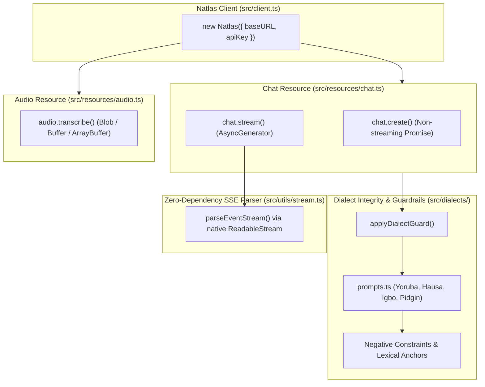

# @natlas/sdk (TypeScript / JavaScript SDK)

[](https://www.npmjs.com/package/@natlas/sdk)
[](https://opensource.org/licenses/MIT)
[](https://www.typescriptlang.org)

The official **zero-runtime-dependency** TypeScript and JavaScript SDK for **N-ATLAS** (Nigeria's sovereign multilingual Large Language Model and Speech Recognition platform).

Built for the **National AI Innovation Challenge (NAIC 2026)** by NCAIR and NITDA under **Problem Statement 01: Developer Infrastructure** (Track B: Innovation & Enterprise).

---

## Architecture



---

## Highlights

- **Zero Runtime Dependencies**: Built entirely on native web standards (`fetch`, `ReadableStream`, `FormData`, `Blob`). Zero vulnerabilities, zero package bloat, instant installation, and universal runtime compatibility.
- **Universal JavaScript Support**: Runs seamlessly across **Node.js 18+**, **Next.js (App & Pages Router, Edge & Node runtimes)**, **Vercel Edge Functions**, **Cloudflare Workers**, **Bun**, and modern **Browsers**.
- **Dialect Guards & Anti-Drift Engine**: Automatic system prompt injection preventing language drift back to English or cross-dialect contamination for **Yorùbá, Hausa, Igbo, and Nigerian Pidgin**.
  - **Hardened Pidgin Guard**: Enforces strict negative constraints against Yoruba/Igbo/Hausa bleed, loaded with authentic Nigerian Pidgin lexical anchors (`wetin`, `dey`, `abeg`, `sha`, `no wahala`, `kwanu`).
- **Wire Protocol Forwarding**: Active forwarding of `language` and `tone_enforcement` parameters directly to backend inference servers.
- **Real-Time Token Streaming**: Native async generator `client.chat.stream()` consuming Server-Sent Events (SSE) for responsive UI applications.
- **Multilingual Voice/ASR**: Direct integration with official `NCAIR1` Whisper checkpoints (`Yoruba-ASR`, `Hausa-ASR`, `Igbo-ASR`, `NigerianAccentedEnglish`).
- **Dual Output Packaging**: Emits modern ESM (`dist/index.mjs`), CommonJS (`dist/index.js`), and strict TypeScript declarations (`dist/index.d.ts`).

---

## Installation

```bash
npm install @natlas/sdk
# or
pnpm add @natlas/sdk
# or
bun add @natlas/sdk
```

---

## Quickstart

### Multilingual Chat Completion
```typescript
import { Natlas } from "@natlas/sdk";

const client = new Natlas({ baseURL: "http://127.0.0.1:8000/v1" });

const response = await client.chat.create({
  language: "yoruba",
  toneEnforcement: true,
  messages: [
    { role: "user", content: "Bawo ni mo se le se iforukọsilẹ ile-iṣẹ mi?" },
  ],
});

console.log(response.choices[0].message.content);
```

### Real-Time Streaming with Dialect Integrity
```typescript
import { Natlas } from "@natlas/sdk";

const client = new Natlas({ baseURL: "http://127.0.0.1:8000/v1" });

for await (const chunk of client.chat.stream({
  language: "pidgin",
  toneEnforcement: true,
  messages: [{ role: "user", content: "Wetin be the best way to register business for CAC?" }],
})) {
  process.stdout.write(chunk.choices[0]?.delta?.content ?? "");
}
```

### Audio / Voice Note Transcription
```typescript
import { Natlas } from "@natlas/sdk";

const client = new Natlas({ baseURL: "http://127.0.0.1:8000/v1" });

const result = await client.audio.transcribe({
  file: audioBlobOrBuffer,
  language: "yoruba",
});

console.log("Transcribed Text:", result.text);
```

---

## Next.js Route Handlers (Edge & Node)

Because `@natlas/sdk` has zero external dependencies, it works out-of-the-box in Next.js Edge runtime handlers without polyfills:

```typescript
// app/api/chat/route.ts
import { Natlas } from "@natlas/sdk";

export const runtime = "edge"; // 100% Edge runtime compatible!

const client = new Natlas({
  baseURL: process.env.NATLAS_BASE_URL || "http://127.0.0.1:8000/v1",
});

export async function POST(req: Request) {
  const { messages, language, toneEnforcement } = await req.json();

  const stream = client.chat.stream({
    language,
    toneEnforcement,
    messages,
  });

  const encoder = new TextEncoder();
  const readable = new ReadableStream({
    async start(controller) {
      for await (const chunk of stream) {
        const text = chunk.choices[0]?.delta?.content ?? "";
        controller.enqueue(encoder.encode(text));
      }
      controller.close();
    },
  });

  return new Response(readable, {
    headers: {
      "Content-Type": "text/plain; charset=utf-8",
      "Cache-Control": "no-cache",
    },
  });
}
```

---

## Development & Testing

```bash
# Install dependencies
pnpm install

# Run test suite
pnpm test

# Type checking and build
pnpm exec tsc --noEmit --skipLibCheck
pnpm build
```
